# Plano Técnico — Weather App

## Architecture

Aplicação web client-side, sem backend próprio na v1. A UI chama um hook de domínio; o hook coordena busca, seleção, consulta meteorológica, unidade e erros. Um serviço único encapsula as chamadas à Open-Meteo, valida respostas e converte DTOs externos para modelos internos.

Fluxo principal: `componentes React → useWeather → weatherService → Open-Meteo`. O retorno percorre o caminho inverso. Funções puras de formatação, conversão e tradução de códigos meteorológicos ficam em `src/lib/`.

Decisões:
- Fazer chamadas HTTP diretamente do navegador; a API selecionada não exige chave secreta.
- Buscar clima atual e previsão diária na mesma chamada de forecast após a seleção da cidade.
- Manter somente estado de tela em memória e a unidade em armazenamento local; não criar backend, cache offline ou gerenciador global de estado.
- Cancelar ou ignorar respostas de consultas anteriores quando uma seleção mais recente as substituir.

## Tech Stack

| Área | Tecnologia | Uso |
|---|---|---|
| UI | React 19.2.7 + React DOM 19.2.7 | Interface e componentes |
| Linguagem/build | TypeScript 6.0.3 strict + Vite 8.0.16 | Tipagem, desenvolvimento e build |
| Estilo | Tailwind CSS 3.4.19 | Layout responsivo conforme o tema do projeto |
| Testes unitários/componentes | Vitest 4.1.9, Testing Library 16.3.2, user-event 14.6.1, jsdom 29.1.1 | Lógica e comportamento da UI |
| Testes E2E | Playwright 1.61.0 | Fluxos em navegadores e viewports suportados |
| Qualidade | Biome 2.5.0 | Lint e formatação |
| Ambiente | Node.js >=22, pnpm 11.8.0 | Instalação e scripts do repositório |

Não adicionar cliente HTTP, biblioteca de estado ou dependência de dados sem uma necessidade comprovada; `fetch`, hooks React e as dependências existentes cobrem o escopo.

## Project Structure

Estrutura proposta para os módulos do plano; não representa implementação:

```text
src/
  App.tsx
  main.tsx
  components/
    SearchBar.tsx
    CurrentWeather.tsx
    ForecastList.tsx
    ForecastCard.tsx
    UnitToggle.tsx
    states/
      EmptyState.tsx
      ErrorState.tsx
      LoadingState.tsx
  hooks/
    useWeather.ts
  services/
    weatherService.ts
  lib/
    format.ts
    temperature.ts
    weatherCodes.ts
  styles/
    index.css
  types/
    weather.ts

tests/
  setup.ts
  unit/
    weatherService.test.ts
    temperature.test.ts
    weatherCodes.test.ts
    useWeather.test.tsx
    App.test.tsx
  e2e/
    weather.spec.ts
```

Responsabilidades: componentes apresentam dados e estados; `useWeather` coordena o fluxo da tela; `weatherService` possui o acesso externo e o mapeamento de resposta; `lib` contém funções puras; `types` contém contratos compartilhados. Evitar novos módulos até surgir duplicação ou responsabilidade distinta.

## Data Model

Os modelos internos usam Celsius como unidade canônica. Valores ausentes permanecem ausentes; a UI os apresenta como indisponíveis, conforme a spec.

```ts
export type Unit =
  | 'celsius' // Unidade canônica e padrão da interface.
  | 'fahrenheit'; // Unidade alternativa para apresentação.

export interface City {
  id?: number; // ID de localidade retornado pelo geocoding.
  name: string; // Nome da cidade retornado em `name`.
  latitude: number; // Latitude usada na consulta meteorológica.
  longitude: number; // Longitude usada na consulta meteorológica.
  adminArea?: string; // Região administrativa mapeada de `admin1`.
  country?: string; // País retornado em `country`.
  countryCode?: string; // Código ISO retornado em `country_code`.
  timezone?: string; // Fuso retornado pelo geocoding, quando disponível.
}

export interface CurrentWeather {
  temperatureC?: number; // Temperatura `current.temperature_2m`, normalizada para °C.
  weatherCode?: number; // Código WMO de `current.weather_code`.
  observedAt?: string; // Horário local de `current.time`.
}

export interface ForecastDay {
  date: string; // Data local de `daily.time`, no formato YYYY-MM-DD.
  minimumC?: number; // Mínima de `daily.temperature_2m_min`, normalizada para °C.
  maximumC?: number; // Máxima de `daily.temperature_2m_max`, normalizada para °C.
  weatherCode?: number; // Código WMO de `daily.weather_code`.
  precipitationProbabilityPercent?: number; // Probabilidade máxima de `daily.precipitation_probability_max`.
}

export interface WeatherData {
  city: City; // Localidade selecionada pela pessoa usuária.
  timezone: string; // Fuso IANA retornado pelo endpoint de forecast.
  current: CurrentWeather | null; // Condições atuais; null se o bloco não existir.
  forecastDays: ForecastDay[]; // Cinco datas; métricas ausentes permanecem opcionais.
}

export type WeatherServiceErrorKind =
  | 'network'
  | 'http'
  | 'timeout'
  | 'invalid-response';

export interface WeatherServiceError {
  kind: WeatherServiceErrorKind;
  status?: number;
  retryAfterSeconds?: number;
}

export type RequestState<T> =
  | { status: 'idle' }
  | { status: 'loading' }
  | { status: 'success'; data: T }
  | { status: 'empty' }
  | { status: 'error'; error: WeatherServiceError };
```

Contratos do serviço:

```ts
searchLocations(query: string, signal?: AbortSignal): Promise<City[]>;
getWeather(city: City, signal?: AbortSignal): Promise<WeatherData>;
```

`searchLocations` retorna lista vazia quando não há correspondências e lança `WeatherServiceError` para falhas técnicas. `getWeather` retorna cinco datas locais; quando a resposta não contém uma data, o adaptador cria a entrada da data sem métricas, para a UI manter os cinco dias identificáveis. Resposta malformada lança `invalid-response`.

## Data Flow

```mermaid
flowchart LR
  person([Pessoa usuária]) --> input[Input de busca]
  input --> valid{Consulta não vazia?}
  valid -- Não --> emptyInput[Orientação para informar cidade]
  emptyInput --> searchUI[Componentes de UI]
  valid -- Sim --> searchLoading[useWeather: searchState loading]
  searchLoading --> geo[weatherService.searchLocations]
  geo --> geoResult{Resultado do geocoding}

  geoResult -- Erro de rede, HTTP ou timeout --> searchError[useWeather: searchState error]
  searchError --> errorUI[ErrorState: erro e tentar novamente]
  errorUI --> searchUI

  geoResult -- Lista vazia --> searchEmpty[useWeather: searchState empty]
  searchEmpty --> emptyUI[EmptyState: nenhuma cidade encontrada]
  emptyUI --> searchUI

  geoResult -- Cidades encontradas --> choices[UI: opções com região e país]
  choices --> selected{Seleção explícita}
  selected --> weatherLoading[useWeather: weatherState loading]
  weatherLoading --> forecast[weatherService.getWeather]
  forecast --> weatherResult{Resultado do forecast}

  weatherResult -- Erro de rede, HTTP ou timeout --> weatherError[useWeather: weatherState error]
  weatherError --> retryUI[ErrorState: erro e tentar novamente]
  retryUI --> searchUI

  weatherResult -- Sem dados --> weatherEmpty[useWeather: weatherState empty]
  weatherEmpty --> noDataUI[EmptyState: dados indisponíveis]
  noDataUI --> searchUI

  weatherResult -- Resposta válida ou parcial --> success[useWeather: weatherState success]
  success --> present[Componentes: clima atual e cinco dias]
  present --> project[Derivar unidade e apresentar campos ausentes]
  project --> searchUI
```



`useWeather` inicia e coordena as solicitações, mantém estados independentes de busca e clima, e descarta respostas obsoletas. Uma resposta parcial segue pelo caminho de sucesso; os componentes mostram os campos disponíveis e marcam os ausentes. A troca Celsius/Fahrenheit apenas recalcula a apresentação, sem nova chamada à API.

## External APIs

### Geocoding

- **URL:** `GET https://geocoding-api.open-meteo.com/v1/search`
- **Parâmetros:** `name` (consulta aparada e codificada como UTF-8), `count=10`, `language=pt`, `format=json`.
- **Exemplo de requisição:**

```text
https://geocoding-api.open-meteo.com/v1/search?name=S%C3%A3o%20Paulo&count=10&language=pt&format=json
```

- **Resposta resumida:**

```json
{
  "results": [
    {
      "id": 3448439,
      "name": "São Paulo",
      "latitude": -23.55,
      "longitude": -46.63,
      "admin1": "São Paulo",
      "country": "Brazil",
      "country_code": "BR",
      "timezone": "America/Sao_Paulo"
    }
  ]
}
```

- **Mapeamento para `City`:** `id` → `id`; `name` → `name`; `latitude`/`longitude` → coordenadas; `admin1` → `adminArea`; `country` → `country`; `country_code` → `countryCode`; `timezone` → `timezone`. Campos geográficos opcionais permanecem ausentes quando a API não os retorna. Sem `results` ou com lista vazia, retornar `[]` — não é erro HTTP.

### Forecast (clima atual e previsão diária)

- **URL:** `GET https://api.open-meteo.com/v1/forecast`
- **Parâmetros relevantes:** `latitude` e `longitude` da `City` selecionada; `current=temperature_2m,weather_code,relative_humidity_2m,wind_speed_10m,precipitation,surface_pressure`; `daily=temperature_2m_min,temperature_2m_max,weather_code,precipitation_probability_max`; `temperature_unit=celsius`; `wind_speed_unit=kmh`; `precipitation_unit=mm`; `timezone=auto`; `forecast_days=5`.
- **Exemplo de requisição:**

```text
https://api.open-meteo.com/v1/forecast?latitude=-23.55&longitude=-46.63&current=temperature_2m%2Cweather_code%2Crelative_humidity_2m%2Cwind_speed_10m%2Cprecipitation%2Csurface_pressure&daily=temperature_2m_min%2Ctemperature_2m_max%2Cweather_code%2Cprecipitation_probability_max&temperature_unit=celsius&wind_speed_unit=kmh&precipitation_unit=mm&timezone=auto&forecast_days=5
```

- **Resposta resumida:**

```json
{
  "timezone": "America/Sao_Paulo",
  "current": {
    "time": "2026-10-29T12:00",
    "temperature_2m": 18.2,
    "weather_code": 1,
    "relative_humidity_2m": 72,
    "wind_speed_10m": 12.4,
    "precipitation": 0,
    "surface_pressure": 1013.2
  },
  "daily": {
    "time": ["2026-10-29", "2026-10-30", "2026-10-31", "2026-11-01", "2026-11-02"],
    "temperature_2m_min": [12.1, 13.0, 14.2, 15.0, 14.7],
    "temperature_2m_max": [21.4, 22.0, 23.1, 24.0, 22.8],
    "weather_code": [1, 2, 3, 0, 61],
    "precipitation_probability_max": [10, 20, 35, 5, 80]
  }
}
```

- **Mapeamento para `WeatherData`:** associar a `City` selecionada ao campo `city`; mapear `timezone` para `timezone`; `current.temperature_2m` → `current.temperatureC`; `current.weather_code` → `current.weatherCode`; `current.time` → `current.observedAt`; `current.relative_humidity_2m` → `current.humidityPercent`; `current.wind_speed_10m` → `current.windSpeedKmh`; `current.precipitation` → `current.precipitationMm`; `current.surface_pressure` → `current.pressureHpa`. Para cada índice `i` de `daily.time`, criar um `ForecastDay`: `time[i]` → `date`, `temperature_2m_min[i]` → `minimumC`, `temperature_2m_max[i]` → `maximumC`, `weather_code[i]` → `weatherCode` e `precipitation_probability_max[i]` → `precipitationProbabilityPercent`.
- Os vetores de `daily` são paralelos: os valores no mesmo índice pertencem à mesma data. Normalizar para as cinco datas locais solicitadas; campo ausente fica `undefined`, dia ausente vira registro sem métricas. `current` ausente vira `null`. Não converter valores inválidos em zero.
- `Unit` é preferência de apresentação: solicitar valores em Celsius e converter no cliente quando a unidade selecionada for Fahrenheit. `weather_code` usa códigos WMO e deve ser traduzido pela tabela interna para pt-BR.

Não há API key. Consultas e coordenadas são enviadas diretamente ao provedor; não registrar esses dados em servidor próprio. Confirmar termos de uso, limites e atribuição da Open-Meteo antes do lançamento.

## State Management

Manter estado da aplicação em `useWeather`, consumido por `App`; não adicionar Redux, Zustand ou React Query. `SearchBar` mantém apenas o texto digitado como estado transitório local e envia a consulta ao hook no submit. `useWeather` é dono de `searchState`, `selectedCity`, `weatherState` e `unit`. Busca e clima têm estados independentes para que um erro de geocoding não substitua o conteúdo meteorológico sem relação com essa falha.

Para cada recurso assíncrono, usar a união discriminada `RequestState<T>` definida em Data Model:

| Estado | Significado | Transição típica |
|---|---|---|
| `idle` | Nenhuma solicitação iniciada. | Inicialização ou limpeza explícita da busca. |
| `loading` | Solicitação em andamento. | Submit de busca, seleção de cidade ou retry. |
| `success` | Há resposta válida para apresentar. | Resposta válida, completa ou parcial. |
| `empty` | Resposta válida sem resultados para o recurso. | Geocoding retorna lista vazia ou recurso meteorológico sem dados. |
| `error` | Solicitação falhou tecnicamente ou a resposta é inválida. | Rede, HTTP, timeout ou validação de payload. |

Uma resposta meteorológica parcial continua em `success`: as propriedades ausentes permanecem opcionais e a UI marca somente esses campos como indisponíveis. O clima atual e a previsão são tratados como seções independentes dentro de `WeatherData`; a ausência de uma não apaga dados válidos da outra. `empty` não representa falha, e `error` não deve ser usado para geocoding sem resultados.

Ler `unit` de `localStorage` durante a inicialização do hook; aceitar somente `celsius` ou `fahrenheit`. Sem valor válido, usar Celsius. Ao alternar, atualizar `unit` e persistir localmente; se o armazenamento estiver bloqueado, manter a unidade em memória na sessão. Não persistir cidade, busca ou clima.

Os dados meteorológicos ficam sempre normalizados em Celsius. Na renderização, cada componente passa o valor Celsius e `unit` a uma função pura de apresentação, por exemplo `toDisplayTemperature(valueC, unit)`. Fahrenheit é derivado pela fórmula `F = C × 9/5 + 32`, com arredondamento definido em NFR; o valor canônico não é alterado. Alternar a unidade não limpa `weatherState`, não muda a cidade e não inicia novo request.

Ao iniciar uma busca ou seleção mais recente, abortar a solicitação anterior com `AbortController` quando possível. Também associar cada solicitação a um identificador sequencial; ignorar respostas cujo identificador não seja o atual, mesmo se o cancelamento não impedir a resposta.

## Error Handling

| Caso | Tratamento |
|---|---|
| Consulta vazia | Não chamar API; orientação junto ao campo de busca. |
| Geocoding sem resultados | Estado vazio, consulta preservada e nenhuma chamada de forecast. |
| Falha de rede | Definir o recurso afetado como `error(network)`; encerrar loading, preservar a cidade selecionada e exibir alerta em pt-BR com retry manual. |
| Erro HTTP | Converter status em `error(http)` sem expor payload técnico. Em `429`, respeitar `Retry-After` antes de habilitar retry; em `5xx`, permitir retry manual. |
| Timeout | Após 10 s, abortar a solicitação e definir `error(timeout)`; encerrar loading e permitir retry manual. Não repetir automaticamente. |
| Resposta inválida | Se JSON ou estrutura obrigatória não puder ser interpretada, definir `error(invalid-response)` apenas no recurso/seção afetado; não renderizar valores inválidos. |
| Resposta parcial válida | Manter `success`; renderizar campos válidos e marcar campos ausentes como indisponíveis. Não converter ausência para zero nem falhar a seção inteira. |
| Recurso válido sem dados | Usar `empty` para a seção sem dados. Se outra seção tiver dados válidos, mantê-la em `success`. |
| Geocoding sem resultados | Usar `empty` no estado de busca; preservar a consulta e não solicitar forecast. |
| Resposta obsoleta | Descartar a resposta quando o identificador da requisição não corresponder à seleção atual. |
| Retry manual | Repetir a mesma busca ou consulta da cidade selecionada; exibir `loading` até sucesso, vazio ou erro. |

Falhas não devem limpar uma cidade selecionada válida, mas dados antigos nunca podem ser rotulados como pertencentes a uma cidade nova. Expor `loading` e feedback neutro em `role=status`; expor falha em `role=alert`. Mensagens visíveis devem estar em pt-BR e oferecer nova tentativa somente para falhas recuperáveis.

## Testing Strategy

- **Vitest — funções puras (`lib/`):** testar conversão °C/°F, arredondamento (incluindo valores negativos e empates), formatação de data no fuso local e tradução de códigos WMO. Cobrir limites e códigos desconhecidos; esses testes não devem depender de React, DOM ou rede.
- **Vitest — serviços (`services/`):** mockar `fetch` e verificar URL/parâmetros dos dois endpoints, codificação Unicode, mapeamento dos DTOs para os modelos internos e alinhamento por índice dos vetores `daily`. Cobrir lista de geocoding vazia, resposta parcial, JSON inválido, HTTP 429/5xx, falha de rede, timeout de 10 s, `AbortSignal` e cabeçalho `Retry-After`.
- **Vitest + Testing Library — hook:** testar transições `idle → loading → success/empty/error`, estados independentes de busca e clima, retry manual, preservação da cidade, descarte de resposta obsoleta e fallback de `localStorage`. Verificar que alternar unidade não chama `fetch` novamente e que respostas parciais permanecem em `success`.
- **Vitest + Testing Library + user-event — componentes:** renderizar cada fluxo em `loading`, `error`, `empty` e `success`; verificar resultados de busca, seleção explícita de homônimas, dados e campos indisponíveis, alternância de unidade e retry. Validar nomes acessíveis, `role=status`, `role=alert`, foco e operação por teclado.
- **Playwright — E2E:** interceptar as rotas Open-Meteo com fixtures; não chamar o serviço real. Cobrir busca com acentos → seleção da cidade → clima atual e cinco datas → alternância °C/°F → recarga e persistência local; cobrir cidade inexistente, falha/timeout seguido de retry e resposta concorrente fora de ordem.
- **Viewports E2E:** executar o fluxo principal em 320 × 640 e 375 × 812 px, e uma verificação de layout em 1280 × 800 px. Validar ausência de rolagem horizontal, controles utilizáveis e fluxo principal por teclado.
- **Rastreabilidade:** vincular testes aos IDs `AC-01.1` a `AC-05.8`; fixar relógio e fuso nos testes de calendário. Fixtures, relógio e rede devem ser determinísticos para evitar testes flakey.

## Risks & Trade-offs

- **Open-Meteo chamada do navegador vs. backend/BFF:** chamadas diretas evitam infraestrutura e segredo de API, coerentes com a v1 sem autenticação. O trade-off é depender da disponibilidade/CORS/limites do fornecedor e enviar a cidade diretamente a terceiro. Alternativa: BFF para cache, controle e observabilidade; adiar até surgir necessidade de segredo, política corporativa ou volume que justifique servidor.
- **Estado no hook local vs. store global/cache de servidor:** `useWeather` mantém o fluxo simples e testável para uma única tela. Redux/Zustand ou React Query adicionariam cache, deduplicação e ferramentas para múltiplas telas, mas aumentariam dependências e conceitos sem requisito atual. Reavaliar se surgirem múltiplos consumidores ou navegação complexa.
- **Celsius canônico + conversão cliente vs. solicitar ambas as unidades:** uma resposta canônica evita request ao alternar e mantém uma fonte de verdade; a conversão pode arredondar a apresentação. Alternativa: requisitar Fahrenheit ao provedor em cada troca, com custo de rede e estados adicionais. A opção da v1 é conversão client-side centralizada e testada.
- **Retry manual sem cache offline vs. retry automático/cache:** retry manual evita tempestade de chamadas e comportamento inesperado diante de limites; em contrapartida, exige ação da pessoa usuária. Cache offline poderia melhorar redes instáveis, mas exige política de validade e risco de exibir previsão desatualizada. Ambos ficam fora da v1.
- **Resumo diário vs. previsão por hora:** dados diários atendem FR-03 e limitam densidade da UI e volume de dados. Previsão horária ajudaria planejamento detalhado, mas está fora do escopo atual e requer nova decisão de produto.
- **Persistir somente a unidade no dispositivo vs. conta/sincronização:** atende a preferência local sem backend; não sincroniza e pode falhar se armazenamento estiver bloqueado. Fallback é Celsius durante a sessão; sincronização requer mudança de escopo.
- **Metas operacionais pendentes:** desempenho, disponibilidade, matriz de navegadores, WCAG e atribuição precisam de aprovação antes do lançamento. Manter essas metas explícitas e não tratá-las como aprovadas por estarem documentadas.
